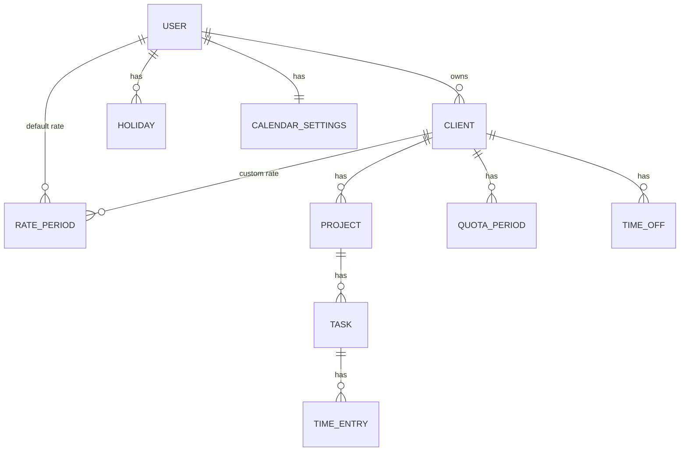

# 03 · Domain model and glossary

> **Status: approved** · Last updated: 2026-10-22
>
> The entities, their relationships and the calculation rules behind [01 Vision and scope](01-vision-and-scope.md) and [02 Requirements](02-requirements.md). Only the project owner's decisions are written here.
>
> This document describes the business concepts. The database tables are designed in 05 Data model.

## 1. Glossary

| Term | Meaning |
|------|---------|
| **Admin** | The user created on the setup screen. Tracks time like any user, and also manages accounts and email settings. Cannot see other users' data. |
| **User** | A person with an account. Owns all their own data. |
| **Client** | Someone the user works for. Has a rate setting, a rounding setting and optional quota periods. |
| **Project** | A group of work under one client. Every client gets a project called "Default". |
| **Task** | A unit of work inside a project, identified by its **title**. Created automatically from time entry titles. |
| **Time entry** | A block of worked time on one task, on one day, with a start and end time and a billable flag. |
| **Timer** | A time entry that has started and not yet stopped. |
| **Rate period** | An hourly rate and currency that apply from a date onward. Belongs to the user's default rate or to a client's custom rate. |
| **Quota period** | A client's expected working time (daily or monthly) for a date range. |
| **Workday** | A day of the week the user normally works. Default Monday to Friday. |
| **Holiday** | A date on which the user doesn't work, such as a national holiday. Entered manually or loaded from an external provider. |
| **Time off** | Vacation or sick days for one client, in full days, paid or unpaid. |
| **Required hours** | How many hours a client's quota expects in a period. |
| **Quota balance** | Hours counted towards the quota minus required hours, for a month. |
| **Overtime** | Hours worked beyond what is expected (see 4.5). |
| **Earnings** | Money from billable time entries: hours × rate. |
| **Salary** | For a month: earnings plus the value of paid time off. |
| **Predicted salary** | Expected salary at the end of the current month (see 4.8). |

## 2. Entities and relationships

### 2.1 User
- Email (login), password, role (**admin** or **user**).
- Settings: time zone, theme (light or dark).
- Default rate: a list of rate periods.
- Calendar settings: workdays, holiday provider (off, or on with a country).

### 2.2 Client
- Belongs to one user. Name. Archived or not.
- Rate mode: **use the user's default rate** or **custom rate** (then it has its own rate periods).
- Rounding: mode (none, down, nearest, up) and step (1, 15, 30 or 60 minutes). New clients: none.
- Quota periods: zero or more.
- Time off: zero or more.

### 2.3 Project
- Belongs to one client and can't be moved. Name. Archived or not.
- Every new client gets a project named "Default", which can be renamed.

### 2.4 Task
- Belongs to one project. Title.
- **Titles are unique within a project, ignoring letter case.**
- Deleted automatically when it has no time entries left.
- Renaming a task to a title that already exists in the project **merges** the two tasks.

### 2.5 Time entry
- Belongs to one task. Billable or non-billable.
- **Date, start time and end time, stored as local wall-clock time.** An entry is never re-interpreted when the user's time zone changes (see 4.1).
- Always within **one day**. Start is before end, and both are on the same date.
- Entries may overlap.
- The **timer** is an entry with a start and no end yet. At most one per user in the MVP. The model must allow several later.

### 2.6 Rate period
- Belongs either to a user (the default rate) or to a client (a custom rate).
- **Valid from** a date, **hourly rate** and **currency**. The currency can change from one period to the next.
- A period lasts until the next period of the same owner starts.

### 2.7 Quota period
- Belongs to one client.
- **Valid from** a date, optional **valid to** date (a contract end), **type** (daily or monthly) and **hours**.
- Periods of one client don't overlap.

### 2.8 Calendar settings and holidays
- Workdays: a set of weekdays. They apply to **all the user's clients**.
- Holidays: a date and a name, with a source (manual or provider). They apply to **all the user's clients**. Loaded holidays can be edited.
- Holiday provider: off (the default) or on with a country.

### 2.9 Time off
- Belongs to one **client**.
- Type: **vacation** or **sick**.
- Date range, full days only.
- **Unpaid**, or **paid** with one of: a percentage, fixed hours or a fixed amount.

## 3. Rules about tasks and titles

- When an entry is saved with a title, the app looks for a task with that title in the selected project, ignoring case. If it finds one, the entry joins it. Otherwise a new task is created.
- Changing an entry's title moves it to another task in the same way.
- A task with no entries is deleted.

## 4. Calculation rules

### 4.1 Time and days
- An entry belongs to the **date it was recorded on**, in local wall-clock time.
- The user's **time zone** is only used to know "now": when a timer starts and stops, what "today" is, and when midnight is reached.
- *Example:* an entry 08:00–10:00 recorded in Poland still shows as 08:00–10:00 after the user moves to the US and changes their time zone.
- The timer stops automatically at midnight in the user's time zone.
- Rounding (per client) is applied to the end time when an entry is saved. Changing the setting later doesn't change saved entries.

### 4.2 Rate lookup
- An entry uses the **rate period that covers its date**: the client's custom periods if the client uses a custom rate, otherwise the user's default periods.
- "Re-rating past entries" means creating a rate period whose **valid from** date is in the past. All entries from that date onward use it.
- **Non-billable entries earn 0.**

### 4.3 Workdays for a client in a period
A day is a **quota workday** for a client when all of these are true:
- it is one of the user's workdays
- it isn't a holiday
- it is inside one of the client's quota periods

A **time off day** is a quota workday that is covered by the client's time off. Non-workdays and holidays inside a time off range don't count.

### 4.4 Expected hours per day
- **Daily quota:** the quota hours.
- **Monthly quota:** monthly hours ÷ the number of quota workdays in that month. A holiday doesn't reduce the monthly total: 160 h stays 160 h, spread over fewer days.
- Contract starting or ending mid-month with a monthly quota: the monthly hours are **prorated** by quota workdays. *Example:* the contract covers 8 of the month's 20 workdays, so 160 h × 8 ÷ 20 = 64 h required. The expected hours per day stay 160 ÷ 20 = 8 h.

### 4.5 Required hours, balance and overtime
- **Required hours** (month) = sum of expected hours over the quota workdays **minus** expected hours on time off days.
  - Daily quota: daily hours × (quota workdays − time off days).
  - Monthly quota: monthly hours − (time off days × expected hours per day).
- **Hours counted towards the quota:** all the client's entries, both billable and non-billable.
- **Overtime:**
  - all hours worked on a non-workday or holiday
  - on a workday, hours above that day's expected hours (e.g. 9 h worked with a 7.5 h daily quota = 1.5 h overtime)
- Overtime is **only a view in the monthly day-by-day quota report**, shown as hours above the quota. Everywhere else (time entries, total reports) the hours are shown as worked: 9 h stays 9 h.
- **Quota balance** = hours counted − required hours. **Overtime is included.**
  - *Example:* required 150 h, worked 145 h on workdays and 10 h on a Saturday. Balance **+5 h**, with 10 h overtime shown separately.
- The balance is per month and doesn't carry over.
- Clients without a quota have no required hours, balance or overtime.

### 4.6 Time off value
- Hours a time off day is worth (the **base**):
  - daily quota: the daily hours
  - monthly quota: the expected hours per day for that month
  - no quota: the hours the user enters
- Paid time off value per day:
  - **percentage:** base × percentage × rate
  - **fixed hours:** fixed hours × rate
  - **fixed amount:** the amount entered
- Unpaid time off has value 0.
- Time off **reduces required hours**. In reports it is shown as its own line (paid leave or sick) and **is included in the totals**.
- For the quota balance, time off is **not** counted as worked hours, because it already reduced the required hours. It is never counted twice.

### 4.7 Earnings and salary
- **Earnings** = sum over billable entries of hours × rate. Totals are **per currency**, with no conversion.
- **Salary** (month) = earnings + the value of paid time off in that month.

### 4.8 Predicted salary
- Only for clients **with a quota**. Clients without a quota have no prediction.
- The app shows **two predictions side by side**:
  - **At normal pace:** salary so far + expected hours for the remaining quota workdays × rate + planned paid time off for the rest of the month. Missing hours from earlier days are not made up.
  - **If you catch up:** as above, plus the hours you're currently behind quota × rate. If you're at or above quota, it equals the normal pace prediction.
- The remaining quota workdays **include today**. Hours already worked today are in salary so far, so today only adds the hours still missing to reach today's expected hours.

## 5. Constraints to keep in the design

- Several simultaneous timers must be possible later without changing the model.
- Each user's data is fully separate, and the admin can't read it.

## 6. Open questions

None. All questions were answered on 2026-10-22.
