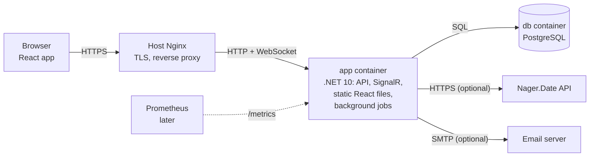

# 04 · Architecture

> **Status: approved** · Last updated: 2026-10-24
>
> How Hourlens is built and run. Section 1 lists the owner's decisions. Sections 2–8 describe the design that follows from them. The options considered for each decision are kept in [Appendix: options considered](#appendix-options-considered).

## 1. Decisions

| # | Topic | Decision |
|---|-------|----------|
| A1 | Repository | One **monorepo**: `frontend/`, `backend/`, `deploy/`, `Documentation/` |
| A2 | Versions | **.NET 10 (LTS)** backend. **React + TypeScript**, built with **Vite** |
| A3 | Backend structure | **Layered**: Domain, Application, Infrastructure, Api |
| A4 | Endpoints | **Controllers** |
| A5 | Database access | **EF Core**, code-first **migrations applied automatically** on app start |
| A6 | API style | **REST + JSON**, described by **OpenAPI**. The TypeScript API client is **generated** from it |
| A7 | Login sessions | **HttpOnly cookie** sessions with **ASP.NET Core Identity** |
| A8 | Serving the UI | React is built into static files and **served by the .NET app**. Two containers: **app** and **db** |
| A9 | Live updates | **Push via SignalR** (WebSockets). Open devices update instantly |
| A10 | Midnight timer stop | A **background job** in the .NET app stops running timers at each user's midnight |
| A11 | Holiday provider | The backend calls **Nager.Date** when the user picks a country, and again for each new year |
| A12 | UI | **Mantine** components + **Mantine Charts** |
| A13 | Data fetching and routing | **TanStack Query** + **React Router** |
| A14 | Images | Built by **GitHub Actions**, pushed to **GHCR**. The server only pulls images |
| A15 | Configuration | A **`.env` file** next to `docker-compose.yml` |
| A15 | Database | **PostgreSQL, newest stable major version** at the start of implementation (19 if it has reached general release by then, otherwise 18) |
| A16 | Observability | Structured JSON logs (Serilog), **`/metrics`** (OpenTelemetry, Prometheus format) and **`/health`**. Prometheus, Grafana and Loki run outside Hourlens, added later |
| A17 | Hosting and CI | Repo on **GitHub**. CI builds and tests every pull request |
| A18 | Live update scope | **Every change** is pushed to the user's open devices |
| A19 | Image tags | Every merge to `main` publishes **`latest`** |
| A20 | Reverse proxy | **Nginx on the host** by default (app bound to `127.0.0.1`). Nginx on another server is supported via `HOURLENS_BIND` and `HOURLENS_TRUSTED_PROXIES` (09, S9) |
| A21 | Background jobs | **Inside the app** (hosted services), no job library |
| A22 | App port | **8080** by default, changeable in `.env` |

## 2. System overview



- The **browser** only talks to one address. Nginx forwards everything to the app container.
- The **app** serves the React files, the REST API under `/api`, and the SignalR hub under `/hubs`.
- Outbound calls happen only when the user enables them: Nager.Date (holiday provider) and the email server (password reset).

## 3. Backend

### 3.1 Project layout

```
backend/
├── Hourlens.sln
├── src/
│   ├── Hourlens.Domain/          entities and calculation rules (03, section 4); no dependencies
│   ├── Hourlens.Application/     use cases, interfaces for outside services
│   ├── Hourlens.Infrastructure/  EF Core, migrations, Identity, email, Nager.Date client
│   └── Hourlens.Api/             controllers, SignalR hub, background jobs, startup; serves the React build
└── tests/
    ├── Hourlens.Domain.Tests/
    ├── Hourlens.Application.Tests/
    └── Hourlens.Api.Tests/       integration tests against a real PostgreSQL
```

Dependencies point inwards: Api → Application → Domain, and Infrastructure → Application → Domain. Domain depends on nothing.

### 3.2 Request flow

1. Browser sends a request with the session cookie to `/api/...`.
2. ASP.NET Core Identity checks the cookie and identifies the user.
3. The controller calls an Application use case.
4. The use case loads data **only for that user** (every query is filtered by user), applies Domain rules and saves through EF Core.
5. If the change affects other open devices (for example the timer started), the app sends a SignalR message to that user's connections.

### 3.3 Live updates (SignalR)

- One hub, `/hubs/updates`. Each connection joins a group for its user, so messages only reach that user's devices.
- The server sends small "something changed" messages. The browser then refetches the affected data through TanStack Query.
- **Every change is pushed** (A18): timer, entries, clients, projects, tasks, rates, quotas, time off, holidays and settings. All open devices stay current.

### 3.4 Background jobs

Run **inside the app** as .NET hosted services, with no job library (A21).

| Job | When | What |
|-----|------|------|
| Midnight timer stop | Every minute | Stops timers for users whose local time has passed midnight; the entry ends at 24:00 of its day |
| Holiday refresh | Daily | For users with the provider on, loads the next year's holidays when they aren't loaded yet |

### 3.5 Authentication

- ASP.NET Core Identity with cookie authentication.
- Session cookie without "remember me", 30-day persistent cookie with it (02, US-AUTH-02).
- Passwords: minimum 8 characters, hashed by Identity.
- Password reset tokens from Identity, emailed when SMTP is configured.
- Setup screen (02, US-SETUP-01) is available only while no account exists.

## 4. Frontend

```
frontend/
├── src/
│   ├── api/          generated OpenAPI client + TanStack Query hooks
│   ├── features/     timer, entries, clients, reports, dashboard, time-off, settings, admin
│   ├── components/   shared UI pieces
│   ├── routes/       React Router route definitions
│   └── realtime/     SignalR connection, invalidates queries on messages
└── vite.config.ts
```

- Mantine for components and theming (light/dark), Mantine Charts for the dashboard and reports.
- Every screen works on a phone (02, US-UI-03).

## 5. Database

- PostgreSQL, accessed only through EF Core.
- Migrations live in Infrastructure and run on app start.
- Schema details: 05 Data model.

## 6. Deployment

### 6.1 Docker Compose

| Service | Image | Notes |
|---------|-------|-------|
| `app` | `ghcr.io/<owner>/hourlens` | .NET app with the React build inside. Published on host port **8080** by default, **configurable in `.env`** in case another service uses it. Bound to **`HOURLENS_BIND`**, default `127.0.0.1` so only Nginx on the same server can reach it. Set to the LAN IP when Nginx runs on another server (09, S9) |
| `db` | `postgres` (version from A15) | Data in a named volume. Not exposed outside the Docker network |

- **Nginx runs on the server itself** (A20), not in a container. It terminates HTTPS and proxies to `app`. It must allow **WebSocket upgrade** for `/hubs/` (SignalR).
- `/metrics` is not proxied by Nginx. Prometheus reaches it inside the Docker network.

### 6.2 Configuration (`.env`)

Expected variables, final names to be fixed in 12 Deployment:

- database name, user and password
- public URL of the app (used in password reset emails)
- host port for the app (default `8080`)
- `HOURLENS_BIND`: address the port is published on (default `127.0.0.1`)
- `HOURLENS_TRUSTED_PROXIES`: IPs or networks allowed to send forwarded headers (default `127.0.0.1`)
- log level

SMTP settings are stored in the database through the admin panel, not in `.env`.

### 6.3 Updating

`docker compose pull && docker compose up -d`. Migrations run automatically on start. Backups are handled by the server (02, NFR-04).

## 7. CI/CD (GitHub Actions)

- **On every pull request:** build backend and frontend, run all tests.
- **Image publishing** (A19): every merge to `main` builds the image and pushes it to GHCR tagged **`latest`**. No version tags for now.

## 8. Observability

- Logs: Serilog, JSON to the console. Read with `docker logs` now, collected by Loki later.
- Metrics: OpenTelemetry, Prometheus format on `/metrics`: HTTP requests, errors, .NET runtime, database.
- Health: `/health` checks the app and the database. Used by the Docker health check.

## 9. Open questions

None. All questions were answered on 2026-10-24.

## Appendix: options considered

Kept for reference. The chosen option for each topic is in section 1.

### A3. Backend code structure

| Option | What it means | Pros | Cons |
|--------|---------------|------|------|
| **a. Single project** | One .NET project, folders per area (`Clients/`, `Timer/`, `Reports/`) | Simplest, least boilerplate | Business rules, database code and HTTP code mix together over time. Harder to test the maths on its own |
| **b. Layered ("Clean Architecture")** | Four projects: **Domain** (entities and calculation rules, no dependencies), **Application** (use cases), **Infrastructure** (EF Core, email, Nager.Date), **Api** (controllers) | Quota, overtime and salary maths live in Domain and can be unit-tested without a database. Very common in .NET, lots of examples | More files and projects. Some ceremony for simple CRUD |
| **c. Vertical slices** | One folder per feature, each with its own endpoint, logic and data access | Each feature is self-contained. Easy to add features | Shared rules (quota maths used by dashboard, reports and predictions) need a separate home anyway |

**Recommendation: b.** The heart of Hourlens is calculation rules (03, section 4). Keeping them in a dependency-free Domain project makes them easy to test thoroughly.

### A4. Controllers or minimal APIs

| Option | What it means | Pros | Cons |
|--------|---------------|------|------|
| **a. Controllers** | Classes like `ClientsController` with methods per endpoint | Familiar structure, groups endpoints naturally, mature OpenAPI support | A bit more code |
| **b. Minimal APIs** | Endpoints declared as functions: `app.MapGet("/clients", ...)` | Less code, slightly faster | With many endpoints you must organize them yourself |

**Recommendation: a.** Both work well in .NET 10. Controllers keep a project with many endpoints tidy without extra conventions.

### A7. How login sessions work

| Option | What it means | Pros | Cons |
|--------|---------------|------|------|
| **a. Cookie session** | After login, the server sets an **HttpOnly cookie**. The browser sends it automatically. JavaScript can't read it | Safest for a browser app: tokens can't be stolen by malicious scripts. "Remember me" (30 days) and logout are simple. Built into **ASP.NET Core Identity** | Only suits browsers on the same site, which is exactly our case |
| **b. JWT tokens** | After login, the server returns a signed token. The frontend stores it and sends it in each request | Good for mobile apps and third-party API clients | Token stored in JavaScript is exposed to scripts. Logout and "remember me" need refresh tokens and extra code |

**Recommendation: a.** The UI and API share one address behind Nginx, and there is no mobile app in the MVP. ASP.NET Core Identity also gives password hashing, password reset tokens (for the email reset) and lockout out of the box.

### A8. How the React app is served

| Option | What it means | Pros | Cons |
|--------|---------------|------|------|
| **a. Served by .NET** | React is built into static files and copied into the .NET image. One **app** container + **Postgres** | Simplest deployment. One address, so cookies just work. One image to update | Frontend and backend are released together (fine for us) |
| **b. Separate frontend container** | A small Nginx container serves React. Your host Nginx routes `/api` to .NET and everything else to it | Frontend and backend can be updated separately | Three containers, more routing config |
| **c. Host Nginx serves the files** | Build files are copied onto the server, and your existing Nginx serves them | No extra container | Deployment is no longer just `docker compose`. Harder to update |

**Recommendation: a.** Two containers in total, and your host Nginx only needs one rule pointing at the app.

### A9. Keeping the timer in sync across devices

**What polling is:** the browser asks the server "has anything changed?" every few seconds. The alternative is **push**, where the server tells the browser the moment something changes, over a live connection (in .NET this is **SignalR**).

The seconds on a running timer tick **locally in the browser** either way. Syncing only matters when you start or stop the timer on another device, such as your phone.

| Option | What it means | Pros | Cons |
|--------|---------------|------|------|
| **a. Refresh on focus + slow polling** | Re-check when you switch back to the tab, and every 30 s while it's open | Very simple, no extra infrastructure. Almost always up to date when you look | Up to 30 s delay if two devices are open side by side |
| **b. Push (SignalR)** | The server notifies all your open devices instantly | Instant | Live connections need extra handling in Nginx (WebSockets) and more code |

**Recommendation: a** for the MVP. It can be switched to b later without changing the data model.

**Chosen by the owner: b (push via SignalR).**

### A12. UI component library and charts

**Component libraries** give ready-made buttons, forms, tables, dialogs and date pickers, so we don't build them ourselves.

| Option | Pros | Cons |
|--------|------|------|
| **Mantine** | Complete set including **date and time pickers**, built-in **dark mode**, good on phones, easy to learn | Smaller community than MUI |
| **MUI (Material UI)** | Most popular, huge community | Google "Material" look is hard to change. Advanced date pickers and charts are partly paid |
| **shadcn/ui + Tailwind** | Modern look, full control: the component code is copied into your repo | You assemble and maintain more yourself. Needs Tailwind knowledge |
| **Ant Design** | Very complete, strong tables and forms | Heavier, enterprise look |

**Chart libraries:**

| Option | Pros | Cons |
|--------|------|------|
| **Recharts** | Built for React, simple, enough for bar, line and pie charts | Fewer advanced chart types |
| **Mantine Charts** | Built on Recharts, matches Mantine's look and dark mode automatically | Only makes sense with Mantine |
| **ECharts** | Very powerful, many chart types | Bigger, less "React-like" API |

**Recommendation: Mantine + Mantine Charts.** Time entry needs good date and time pickers, the app needs dark mode, and it must work on phones. Mantine covers all three for free.

### A13. Fetching data from the API

**What TanStack Query is:** a library that handles talking to the API from React. It **caches** responses, shows loading and error states, **refetches** when you return to the tab (that's how A9 option a works), and updates the screen after you save something. Without it, each screen writes this logic by hand.

| Option | Pros | Cons |
|--------|------|------|
| **TanStack Query** | Standard choice, handles caching, refetch on focus, polling and retries | One more library to learn |
| **SWR** | Similar idea, smaller | Fewer features for saving data |
| **Plain `fetch` + `useEffect`** | No library | Lots of repeated code, easy to get loading and caching bugs |

**Recommendation: TanStack Query.**

### A14. How Docker images are built

| Option | What it means | Pros | Cons |
|--------|---------------|------|------|
| **a. Build on the server** | `git pull` then `docker compose build` on your server | No registry needed | Builds use your server's CPU and take a few minutes. Server needs the source code |
| **b. GitHub Actions + GHCR** | When you merge or tag a release, GitHub builds the image and pushes it to **GitHub Container Registry**. The server runs `docker compose pull && docker compose up -d` | Server only downloads ready images. Every version is tagged, so rolling back is one command. Same images CI tested | Needs a GitHub workflow and registry login (free for personal use) |

**Recommendation: b.** It fits "install like a real self-hosted app": the server only needs `docker-compose.yml` and `.env`.

### A16. Logging and monitoring (Prometheus and Grafana later)

To be ready for Prometheus and Grafana, the app should produce the right signals now, even if the monitoring stack comes later.

| Signal | Proposal | Later use |
|--------|----------|-----------|
| **Logs** | **Structured JSON logs** to the console (Serilog) | Collected by **Loki** (with Promtail or Alloy) and searched in Grafana |
| **Metrics** | A **`/metrics` endpoint** using **OpenTelemetry**: request counts and timings, errors, .NET runtime and database stats | Scraped by **Prometheus**, dashboards in **Grafana** |
| **Health** | **`/health`** endpoint (app and database) | Docker health check, uptime monitoring |

| Option | What it means |
|--------|---------------|
| **a. Instrument now, monitor later** | The MVP ships logs, `/metrics` and `/health`. Prometheus, Grafana and Loki are added to your homelab whenever you want, with no app changes |
| **b. Monitoring included in the Hourlens compose file** | Prometheus and Grafana containers ship with Hourlens |
| **c. Logs only for now** | Add metrics later |

**Recommendation: a.** Most homelabs run one shared Prometheus/Grafana for all services, so Hourlens should expose metrics rather than bundle its own stack. `/metrics` should only be reachable inside the Docker network, not through the public Nginx address.

