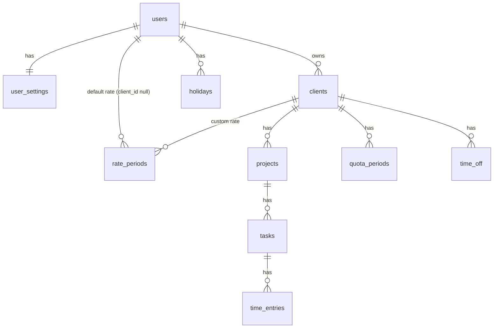

# 05 · Data model

> **Status: approved** · Last updated: 2026-10-24
>
> The PostgreSQL schema behind the entities in [03 Domain model](03-domain-model.md), using the decisions in [04 Architecture](04-architecture.md).

## 1. Conventions

| # | Rule |
|---|------|
| M1 | Primary keys are **UUID v7**, generated by the app (`Guid.CreateVersion7()`) |
| M2 | Table and column names are **snake_case**, tables in plural (`time_entries`) |
| M3 | Every table has **`created_at`** and **`updated_at`** (`timestamptz`, UTC) |
| M4 | Deletes are **real deletes**. Archiving is a separate column |
| M5 | Money is **`numeric(12,2)`**. Currency is a **3-letter ISO 4217 code** (`char(3)`) |
| M6 | Any ISO 4217 currency is allowed. The app validates the code against the ISO list |
| M7 | Hour amounts (quotas, time off hours) are stored as **whole minutes** (`integer`). 7.5 h = 450 |
| M8 | Time entry times are stored **to the second**. Rounding per client is applied on save |
| M10 | Rows that can be edited from two devices use **optimistic concurrency** (PostgreSQL `xmin`). A conflicting save is rejected with "this changed, reload" |
| M11 | Overlapping periods are checked by the **app** (friendly errors) **and** by **database constraints** (safety net) |
| — | **Every user-owned table has a `user_id` column**, and every query filters by it. This enforces "each user sees only their own data" (01, 2.2) |
| — | Migrations are EF Core code-first, applied on app start (04, A5) |

## 2. Diagram

Deleting a parent deletes its children (`ON DELETE CASCADE`), matching 02: deleting a client removes its projects, tasks, entries, time off, rates and quotas. Deleting a user removes all their data.

## 3. Accounts and settings

### 3.1 Identity tables (M15)

ASP.NET Core Identity's standard tables, renamed to snake_case:

| Table | Purpose |
|-------|---------|
| `users` | Account: `id`, `email`, `normalized_email`, `password_hash`, `security_stamp`, `concurrency_stamp`, lockout fields |
| `roles` | `admin`, `user` |
| `user_roles` | Which role each user has |
| `user_tokens`, `user_claims`, `user_logins`, `role_claims` | Standard Identity tables, mostly unused in the MVP |

- `email` is unique and is the login (02, US-AUTH-01).
- Password reset tokens are generated by Identity and need no table of our own.

### 3.2 `user_settings` (M13)

| Column | Type | Notes |
|--------|------|-------|
| `user_id` | uuid, PK, FK → users | One row per user |
| `time_zone` | text | IANA name, e.g. `Europe/Warsaw`. Set from the browser on first login |
| `theme` | text | `light` or `dark` |
| `workdays` | smallint[] | ISO weekday numbers, 1 = Monday … 7 = Sunday. Default `{1,2,3,4,5}` |
| `holiday_provider_country` | char(2), null | ISO country code. Null = provider off (default) |

### 3.3 `app_settings` (instance-wide, one row)

| Column | Type | Notes |
|--------|------|-------|
| `id` | smallint, PK | Always 1 |
| `smtp_host`, `smtp_port`, `smtp_username`, `smtp_from`, `smtp_use_tls` | text / int / text / text / bool | All null until the admin configures email |
| `smtp_password_encrypted` | text, null | **Encrypted** with ASP.NET Data Protection (M14). The keys are stored in a **Docker volume**, never in the database |

## 4. Work structure

### 4.1 `clients`

| Column | Type | Notes |
|--------|------|-------|
| `id` | uuid, PK | |
| `user_id` | uuid, FK → users | |
| `name` | text | **Unique per user**, ignoring case (M16) |
| `rate_mode` | text | `default` (use the user's default rate) or `custom` |
| `rounding_mode` | text | `none`, `down`, `nearest`, `up`. Default `none` |
| `rounding_step_minutes` | smallint | 1, 15, 30 or 60 |
| `archived_at` | timestamptz, null | Null = active. Set = archived, and records when (M20) |

### 4.2 `projects`

| Column | Type | Notes |
|--------|------|-------|
| `id` | uuid, PK | |
| `user_id` | uuid, FK → users | |
| `client_id` | uuid, FK → clients | Can't change after creation (02, US-ORG-02) |
| `name` | text | "Default" for the project created with the client. **Unique per client**, ignoring case (M16) |
| `archived_at` | timestamptz, null | |

### 4.3 `tasks`

| Column | Type | Notes |
|--------|------|-------|
| `id` | uuid, PK | |
| `user_id` | uuid, FK → users | |
| `project_id` | uuid, FK → projects | |
| `title` | text | As the user typed it |

- **Unique index on `(project_id, lower(title))`**: one task per title per project, ignoring case (03, 2.4).
- A task with no entries is deleted by the app in the same transaction that removes or moves its last entry.

### 4.4 `time_entries`

| Column | Type | Notes |
|--------|------|-------|
| `id` | uuid, PK | |
| `user_id` | uuid, FK → users | |
| `task_id` | uuid, FK → tasks | Every entry has a task (01, 3.1) |
| `entry_date` | date | Local date (03, 4.1) |
| `start_time` | time(0) | Local wall-clock time, to the second |
| `end_time` | time(0), null | **Null = running timer.** `24:00:00` is allowed (timer stopped at midnight) |
| `started_at_utc` | timestamptz, null | Real start moment, set for timer entries (M9). Used by the midnight job and live updates |
| `is_billable` | boolean | |
| `xmin` | (system column) | Concurrency token (M10) |

Constraints and indexes:
- `CHECK (end_time IS NULL OR end_time > start_time)`: entries stay within one day. Rounding never breaks this (03, 4.1, C1), and a timer across the autumn clock change is saved as described in 03, 4.1 (C5).
- **Partial unique index `(user_id) WHERE end_time IS NULL`**: at most one running timer per user. Dropping this index is all it takes to allow several timers later (01, 3.2).
- Index `(user_id, entry_date)` for day, month and year reports.
- Index `(task_id)`.

## 5. Money and calendar

### 5.1 `rate_periods`

| Column | Type | Notes |
|--------|------|-------|
| `id` | uuid, PK | |
| `user_id` | uuid, FK → users | |
| `client_id` | uuid, null, FK → clients | **Null = the user's default rate**. Set = that client's custom rate |
| `valid_from` | date | |
| `hourly_rate` | numeric(12,2) | |
| `currency` | char(3) | Can differ between periods (03, 2.6) |

- **Unique `(user_id, client_id, valid_from) NULLS NOT DISTINCT`**: no two periods of the same owner start on the same day. A period ends where the next one starts, so they can't overlap.

### 5.2 `quota_periods`

| Column | Type | Notes |
|--------|------|-------|
| `id` | uuid, PK | |
| `user_id` | uuid, FK → users | |
| `client_id` | uuid, FK → clients | |
| `valid_from` | date | |
| `valid_to` | date, null | Null = open-ended. Inclusive |
| `quota_type` | text | `daily` or `monthly` |
| `minutes` | integer | Daily minutes, or monthly minutes |

- **Exclusion constraint** (needs the `btree_gist` extension): no two periods of the same client overlap.
  `EXCLUDE USING gist (client_id WITH =, daterange(valid_from, valid_to, '[]') WITH &&)`

### 5.3 `holidays`

| Column | Type | Notes |
|--------|------|-------|
| `id` | uuid, PK | |
| `user_id` | uuid, FK → users | |
| `date` | date | |
| `name` | text | |
| `source` | text | `manual` or `provider` |

- **Unique `(user_id, date)`**: one holiday per date per user (M18).
- The yearly refresh job (04, 3.4) checks whether provider holidays exist for the next year.

### 5.4 `time_off`

| Column | Type | Notes |
|--------|------|-------|
| `id` | uuid, PK | |
| `user_id` | uuid, FK → users | |
| `client_id` | uuid, FK → clients | Time off is per client (03, 2.9) |
| `type` | text | `vacation` or `sick` |
| `start_date`, `end_date` | date | Full days, inclusive |
| `is_paid` | boolean | |
| `pay_mode` | text, null | `percentage`, `fixed_hours` or `fixed_amount`. Null when unpaid |
| `percentage` | numeric(5,2), null | For `percentage`, e.g. 80.00 |
| `fixed_minutes` | integer, null | For `fixed_hours`, per day |
| `fixed_amount` | numeric(12,2), null | For `fixed_amount`, per day. Currency = the client's rate currency on that date (M12) |
| `base_minutes` | integer, null | Hours a day is worth, entered by the user when the client has no quota (03, 4.6) |

- `CHECK (end_date >= start_date)`
- A check constraint ensures exactly the field for the chosen `pay_mode` is filled.
- **Exclusion constraint**: time off of the same client can't overlap, whatever the type (M19).
  `EXCLUDE USING gist (client_id WITH =, daterange(start_date, end_date, '[]') WITH &&)`

## 6. Value formats

- Columns with a fixed set of values (`rate_mode`, `rounding_mode`, `quota_type`, `type`, `pay_mode`, `source`, `theme`) are stored as **`text` with a `CHECK` constraint** listing the allowed values (M17). No PostgreSQL enum types.

## 7. Open questions

None. All questions were answered on 2026-10-24.
